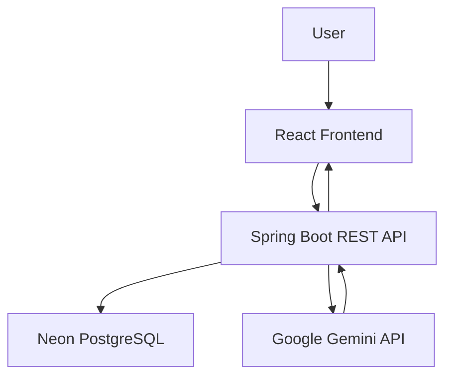
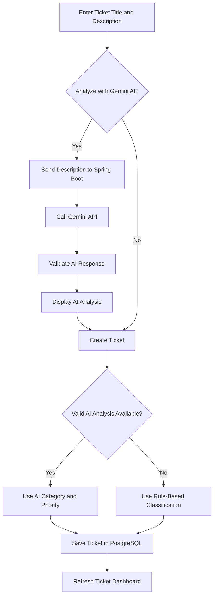

# AI-Powered Support Triage System

An AI-powered, full-stack support ticket management application built using **React, Java, Spring Boot, PostgreSQL, and Google Gemini AI**.

The application helps support engineers analyze technical incidents, classify issues, assign priorities, and generate troubleshooting recommendations using AI.

It also provides a dashboard for creating, viewing, and managing support tickets.

## Live Application

**Frontend:**  
https://ai-support-triage-frontend.onrender.com

**Backend API:**  
https://ai-support-triage-backend.onrender.com/api/tickets

**GitHub Repository:**  
https://github.com/fathimat/ai-support-triage-system

> Note: The backend is an API service. Its root URL may return HTTP 404 because no homepage endpoint is configured.

---

## 1. Project Overview

Support engineers often spend significant time investigating customer issues, identifying the affected application component, and determining incident severity.

The AI-Powered Support Triage System demonstrates how artificial intelligence can assist with these activities.

Users can:

- Create technical support tickets.
- Analyze incident descriptions using Google Gemini AI.
- Automatically classify issues into technical categories.
- Identify the likely priority of an incident.
- Generate technical summaries.
- Receive troubleshooting recommendations.
- Store and retrieve tickets using PostgreSQL.
- View ticket information through a React dashboard.

The system also supports rule-based classification as a fallback when an AI analysis is unavailable.

## 2. Key Features

### AI-Powered Ticket Analysis

Google Gemini AI analyzes the incident description and generates:

- **Category:** Application, Database, Network, Access, or General.
- **Priority:** Low, Medium, High, or Critical.
- **Technical Summary:** A concise explanation of the incident.
- **Troubleshooting Steps:** Suggested technical investigation steps.

### Ticket Creation

Users can enter a ticket title and issue description, optionally analyze the issue using Gemini AI, and create a support ticket.

When a valid AI analysis is available for the current description, its category and priority can be used during ticket creation.

Otherwise, the application falls back to predefined classification rules.

### Ticket Dashboard

The React dashboard displays stored tickets and supports viewing ticket details.

### Database Persistence

Tickets are stored in a cloud-hosted PostgreSQL database using Neon.

Created tickets remain available after the browser is refreshed.

### Responsive User Interface

The frontend includes a ticket creation form, loading states, error handling, and a compact Gemini AI analysis results panel.

## 3. Technology Stack

| Layer | Technology |
|---|---|
| Frontend | React, JavaScript, Vite |
| Styling | CSS |
| Backend | Java 21, Spring Boot |
| Build Tool | Gradle |
| Database | PostgreSQL |
| Cloud Database | Neon |
| AI Integration | Google Gemini API |
| HTTP Communication | REST APIs, JSON |
| Version Control | Git, GitHub |
| Hosting | Render |
| Development Tools | VS Code, PowerShell |

## 4. System Architecture



### Component Responsibilities

**React Frontend**

- Displays the dashboard.
- Collects ticket information.
- Sends API requests.
- Displays Gemini AI analysis results.
- Displays tickets retrieved from the backend.

**Spring Boot Backend**

- Provides REST API endpoints.
- Processes ticket creation requests.
- Integrates with Gemini AI.
- Validates AI-generated classifications.
- Communicates with PostgreSQL.

**Google Gemini AI**

- Analyzes technical issue descriptions.
- Generates category and priority recommendations.
- Produces technical summaries.
- Suggests troubleshooting steps.

**Neon PostgreSQL**

- Stores support ticket records.
- Provides persistent cloud database storage.

## 5. Application Workflow

### AI Analysis and Ticket Creation



### Detailed Flow

1. A user enters the ticket title and description.
2. The user optionally selects **Analyze with Gemini AI**.
3. React sends the description to the Spring Boot backend.
4. The backend sends an analysis request to Google Gemini.
5. Gemini returns a structured technical analysis.
6. The backend validates the returned information.
7. React displays the category, priority, summary, and troubleshooting steps.
8. The user selects **Analyse and create ticket**.
9. The application uses a valid AI classification when available, otherwise rule-based classification.
10. Spring Boot saves the ticket in PostgreSQL.
11. The dashboard retrieves and displays the saved ticket.

## 6. REST API Endpoints

### Get All Tickets

**GET** `/api/tickets`

Example:

```http
GET https://ai-support-triage-backend.onrender.com/api/tickets
```

Example response:

```json
[
  {
    "id": 1,
    "title": "Production API failure",
    "description": "Users are receiving HTTP 500 errors.",
    "category": "Application",
    "priority": "Critical",
    "status": "Open"
  }
]
```

### Create a Ticket

**POST** `/api/tickets`

Example request:

```json
{
  "title": "Database Slow Query",
  "description": "Database queries are timing out.",
  "category": "Database",
  "priority": "High",
  "status": "Open"
}
```

The backend creates and stores the ticket and returns the saved ticket information.

### Analyze a Ticket Using Gemini AI

**POST** `/api/ai/analyze`

Example request:

```json
{
  "description": "Production database queries are extremely slow and users are experiencing timeouts."
}
```

Example response:

```json
{
  "analysis": {
    "category": "Database",
    "priority": "Critical",
    "summary": "Production database performance degradation causing query timeouts for end users.",
    "troubleshootingSteps": [
      "Check current database CPU, memory, and disk I/O utilization.",
      "Identify and analyze long-running or active blocking queries.",
      "Review database error logs and connection pool saturation metrics.",
      "Verify recent deployments, schema changes, or unindexed queries."
    ]
  }
}
```

AI-generated results may vary depending on the incident description.

## 7. Project Structure

```text
AI-Support-Triage-System/
|
|-- README.md
|-- .gitignore
|
|-- support-triage/
|   |-- src/
|   |   |-- App.jsx
|   |   |-- App.css
|   |   |-- main.jsx
|   |   |-- index.css
|   |
|   |-- public/
|   |-- package.json
|   |-- package-lock.json
|   |-- vite.config.js
|
|-- support-triage-backend/
    |-- src/main/java/com/supporttriage/
    |   support_triage_backend/
    |   |-- SupportTriageBackendApplication.java
    |   |-- Ticket.java
    |   |-- TicketController.java
    |   |-- TicketRepository.java
    |   |-- ai/
    |       |-- AiTicketController.java
    |       |-- GeminiService.java
    |
    |-- src/main/resources/
    |   |-- application.properties
    |   |-- application-cloud.properties
    |
    |-- Dockerfile
    |-- build.gradle
    |-- gradlew.bat
```

The local configuration file `application-local.properties` is intentionally excluded from version control.

## 8. Running the Application Locally

### Prerequisites

- Java 21
- Node.js and npm
- PostgreSQL database access
- Google Gemini API key
- Git

### Clone the Repository

```bash
git clone https://github.com/fathimat/ai-support-triage-system.git
cd ai-support-triage-system
```

### Backend Setup

Navigate to the backend:

```bash
cd support-triage-backend
```

Create:

`src/main/resources/application-local.properties`

Configure your local database settings using the appropriate Spring Boot datasource properties.

For example:

```properties
spring.datasource.url=jdbc:postgresql://YOUR_NEON_HOST/neondb?sslmode=require
spring.datasource.username=YOUR_DATABASE_USERNAME
spring.datasource.password=YOUR_DATABASE_PASSWORD
```

Do not commit this file.

Configure your Gemini API key as an environment variable.

In PowerShell:

```powershell
$env:GEMINI_API_KEY="YOUR_GEMINI_API_KEY"
```

Start the backend:

```powershell
.\gradlew.bat bootRun --args="--spring.profiles.active=local"
```

The backend runs at:

`http://localhost:8080`

### Frontend Setup

Open another terminal and navigate to:

```bash
cd support-triage
```

Install dependencies:

```bash
npm install
```

Create a `.env.local` file if you need to override the API URL:

```env
VITE_API_BASE_URL=http://localhost:8080
```

Start React:

```bash
npm run dev
```

Open the local address displayed by Vite, normally:

`http://localhost:5173`

## 9. Environment Variables

### Backend

| Variable | Purpose |
|---|---|
| `SPRING_PROFILES_ACTIVE` | Selects the Spring Boot profile |
| `DATABASE_URL` | PostgreSQL JDBC connection URL |
| `DATABASE_USERNAME` | PostgreSQL username |
| `DATABASE_PASSWORD` | PostgreSQL password |
| `GEMINI_API_KEY` | Google Gemini API authentication |

### Frontend

| Variable | Purpose |
|---|---|
| `VITE_API_BASE_URL` | Base URL of the Spring Boot API |

The Gemini API key must remain on the backend. It must not be exposed through React environment variables.

## 10. Cloud Deployment

The application uses separate Render services.

### Backend

- **Service:** `ai-support-triage-backend`
- **Type:** Web Service
- **Runtime:** Docker
- **Branch:** `master`
- **Root Directory:** `support-triage-backend`
- **Spring Profile:** `cloud`

Backend URL:

https://ai-support-triage-backend.onrender.com

### Frontend

- **Service:** `ai-support-triage-frontend`
- **Type:** Static Site
- **Branch:** `master`
- **Root Directory:** `support-triage`
- **Build Command:** `npm install && npm run build`
- **Publish Directory:** `dist`

Frontend URL:

https://ai-support-triage-frontend.onrender.com

The frontend uses:

```env
VITE_API_BASE_URL=https://ai-support-triage-backend.onrender.com
```

### Database

The deployed backend connects to a separate Neon PostgreSQL project named:

`ai-support-triage-system`

This database is independent of the original non-AI Support Triage System.

## 11. Security and Reliability

The project uses several practices to improve security and reliability:

- Database credentials are kept out of the committed source code.
- The Gemini API key is configured on the backend.
- Local configuration is excluded through `.gitignore`.
- Cloud configuration reads environment variables.
- CORS allows the intended React frontend origins.
- Gemini responses are validated before their classification values are used.
- Rule-based classification provides a fallback.
- The React frontend ignores outdated AI responses when the description changes.
- Loading states help prevent duplicate or conflicting user actions.

This project is a portfolio demonstration and is not presented as a fully hardened enterprise support platform.

## 12. Testing and Verification

The following scenarios have been tested successfully:

| Test | Result |
|---|---|
| Backend deployed on Render | Passed |
| GET `/api/tickets` | Passed |
| PostgreSQL database connection | Passed |
| Gemini AI analysis endpoint | Passed |
| React frontend deployment | Passed |
| Ticket dashboard loading | Passed |
| AI-generated category and priority | Passed |
| Ticket creation | Passed |
| Ticket persistence after refresh | Passed |
| Compact AI analysis UI | Passed |

### Example Verified Scenario

**Incident:** Production API failure following deployment.

**AI Category:** Application

**AI Priority:** Critical

**Result:** The ticket was successfully created and remained visible after refreshing the application.

## 13. Future Improvements

Potential enhancements include:

- User authentication and role-based access.
- Ticket assignment and ownership.
- Ticket status updates and resolution tracking.
- Search, sorting, and pagination.
- AI-assisted root cause investigation.
- Ticket history and audit logs.
- Monitoring, metrics, and reporting.
- Automated tests and CI/CD quality checks.
- Improved accessibility and mobile responsiveness.

## 14. Learning Outcomes

This project demonstrates practical experience with:

- Java and Spring Boot REST API development.
- React frontend development.
- PostgreSQL database integration.
- Google Gemini API integration.
- AI-assisted technical troubleshooting.
- Input and response validation.
- Rule-based fallback logic.
- Cloud deployment using Render and Neon.
- Git and GitHub version control.
- End-to-end application testing.

## 15. Project Purpose

This application was developed as a portfolio project to demonstrate full-stack software engineering, application troubleshooting, AI integration, and cloud deployment skills.

It reflects a real-world support workflow in which technical incidents are analyzed, classified, prioritized, and recorded for further investigation.

---

**Built with React, Java Spring Boot, PostgreSQL, and Google Gemini AI.**
